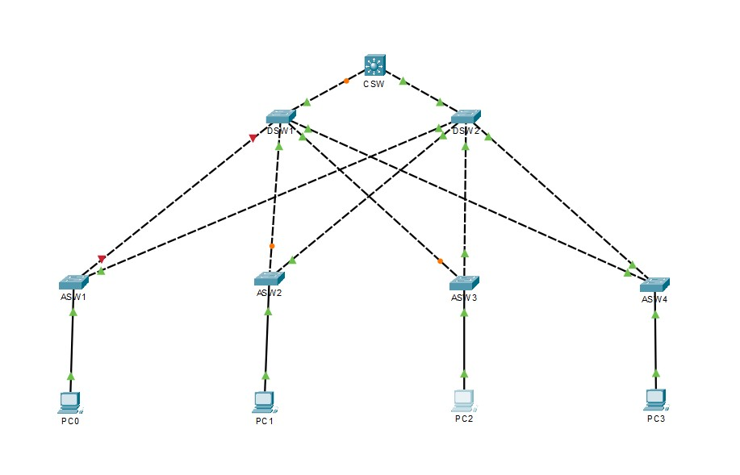
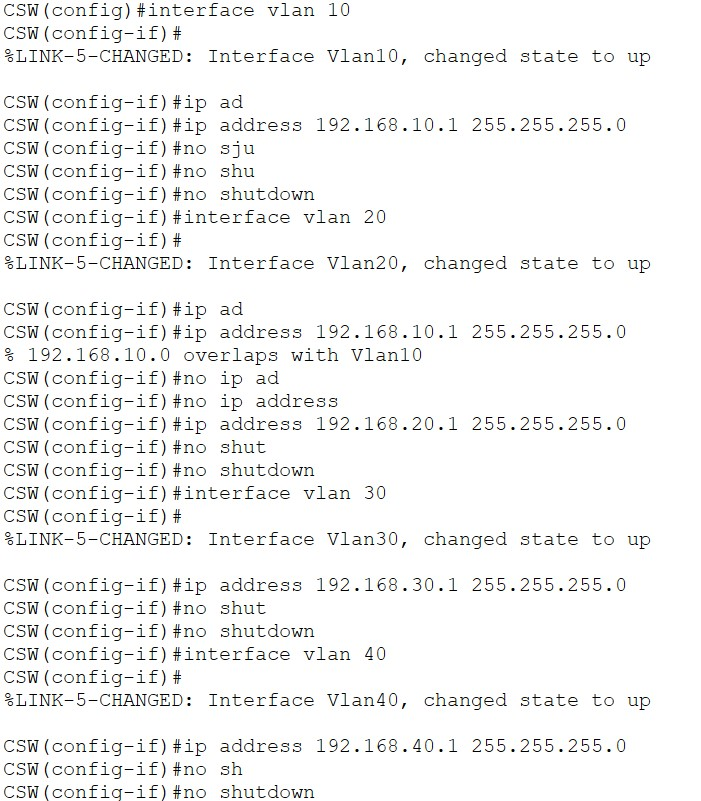
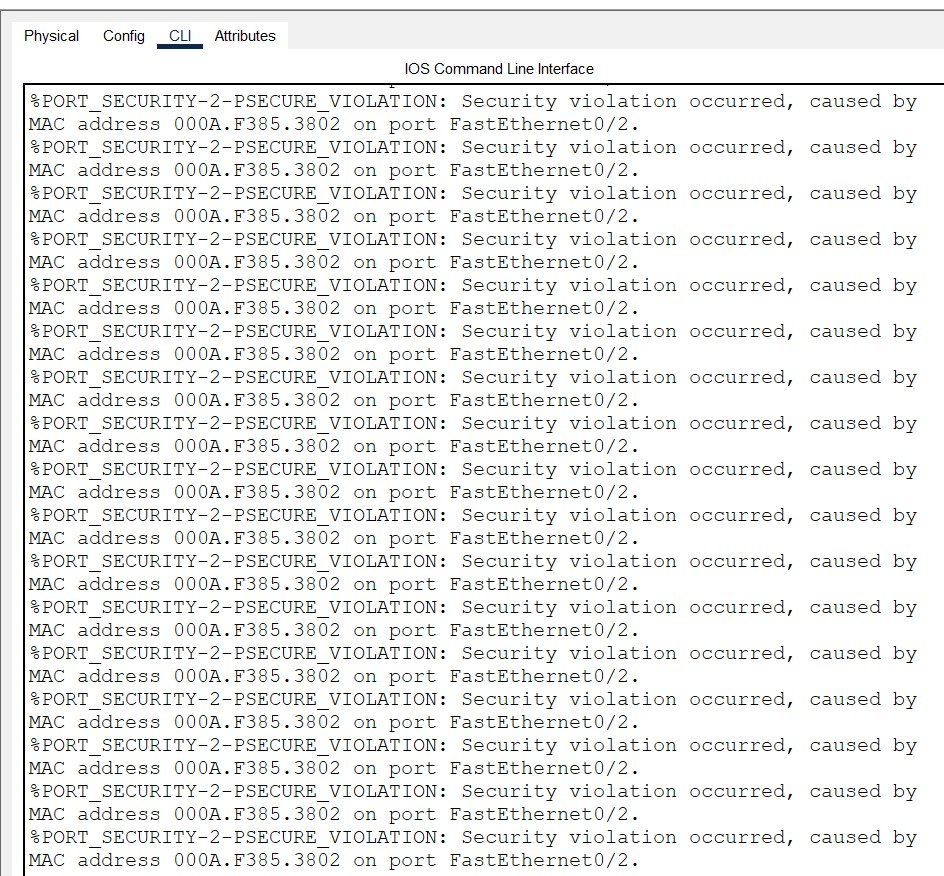
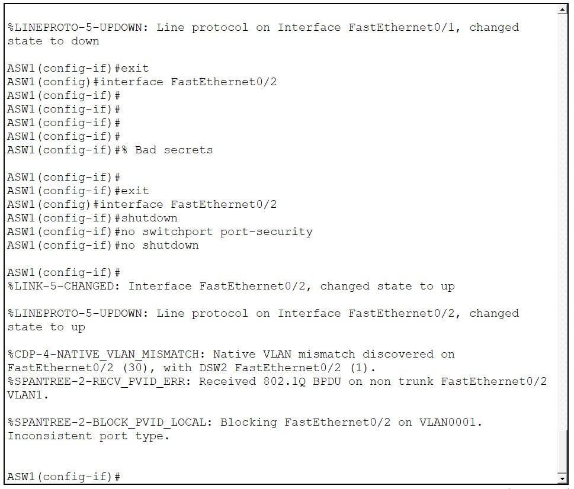
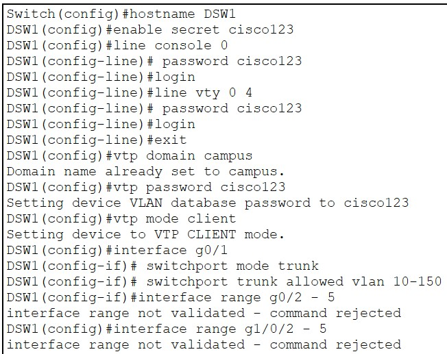
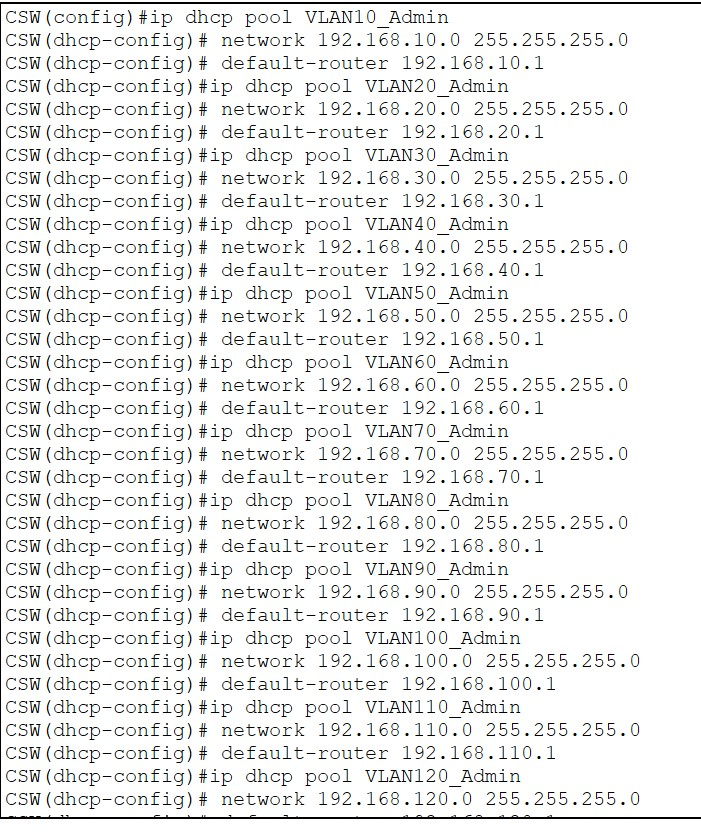
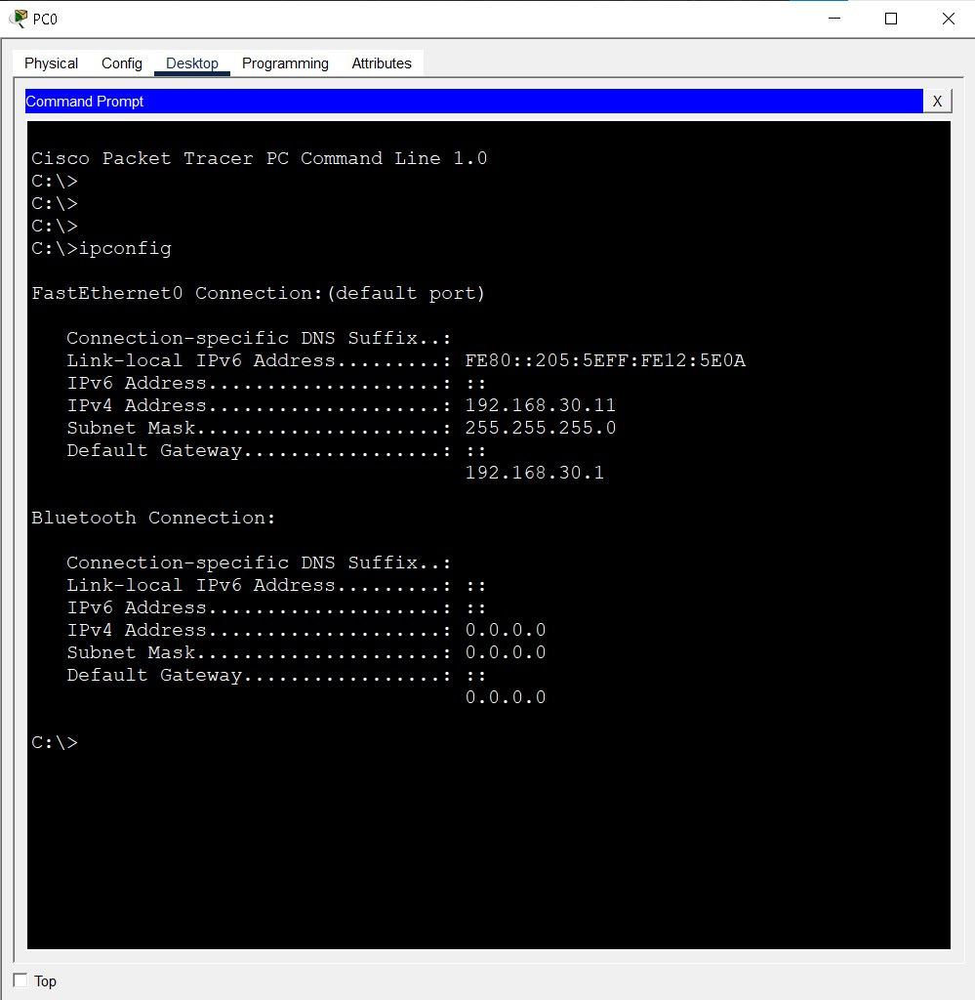
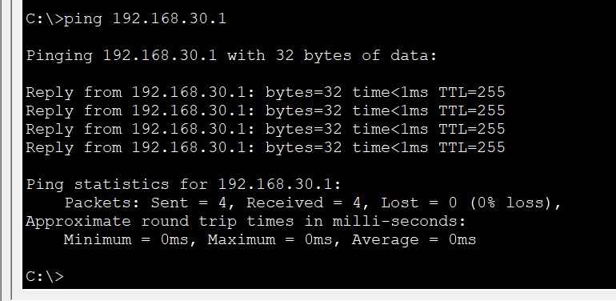
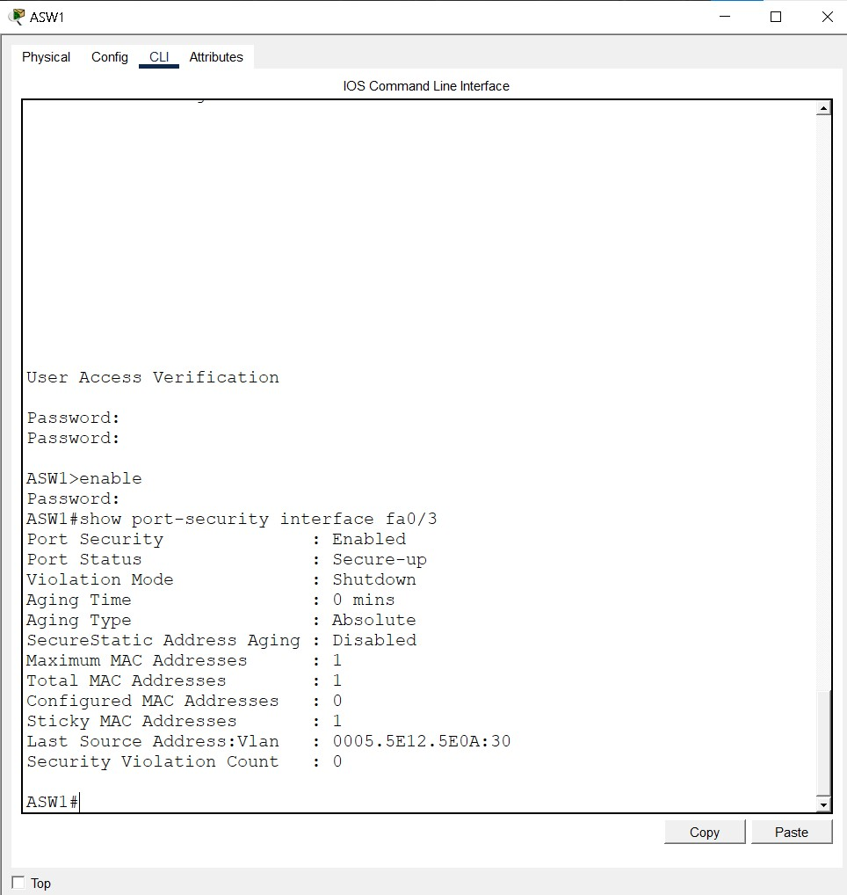

# 🏫 Enterprise Campus Network Architecture & Security (ECNAS)


## 📖 Project Overview

This repository contains a fully functional, highly available **Three-Tier Campus Network** designed for a simulated international school campus. The goal was not just to configure devices, but to build a real-world topology, simulate hardware limitations, and document the troubleshooting process when things inevitably break.

The network supports over 200+ endpoints across 15 VLANs, utilizing dynamic routing, centralized VLAN management, and strict edge security.

## 🗺️ Network Topology

Below is the final operational topology. Note the redundant links (Spanning Tree Protocol is actively blocking orange links to prevent loops) and the end devices connected across different Access Switches.



---

## 🧠 Networking Concepts (For Beginners)
*If you are new to networking, here is a simple explanation of what is happening in this lab.*

- **Three-Tier Architecture:** Imagine a company. The Access layer is the reception desk (where employees connect). The Distribution layer is the floor managers (routing traffic between departments). The Core layer is the CEO (making the big decisions and routing traffic to the outside world).
- **VLAN (Virtual Local Area Network):** Think of it as building virtual walls inside a physical building. Even if the Students and the Faculty are plugged into the same switch, VLANs keep their traffic completely separate for security.
- **DHCP (Dynamic Host Configuration Protocol):** Like a hotel receptionist. When a device connects, DHCP automatically hands it an IP address, a subnet mask, and a gateway so it can communicate.
- **VTP (VLAN Trunking Protocol):** Instead of typing the 15 VLAN names into every single switch manually, VTP allows one "Server" switch to push the VLAN database to all "Client" switches automatically.
- **STP (Spanning Tree Protocol):** If you connect switches in a loop (for redundancy), broadcast traffic will circle forever and crash the network (a broadcast storm). STP acts like a traffic cop, blocking one path but keeping it on standby.
- **Port Security:** A bouncer at the door. It learns the MAC address of the PC plugged into a port. If someone unplugs that PC and plugs in a hacker's laptop, the port shuts down immediately.

---

## 🛠️ The Troubleshooting Log (Real-World Scenarios)

*This is the most important part of the repo. Anyone can type commands; an engineer knows how to fix it when it breaks.*

### 1. The SVI Subnet Overlap

- **The Issue:** While configuring SVIs on the Core Switch, the CLI rejected the IP address for VLAN 20 because it overlapped with VLAN 10.
- **The Fix:** I had copy-pasted the IP address without changing the third octet. I removed the incorrect IP (`no ip address`) and applied the correct subnet (`192.168.20.1`).

### 2. The Infamous Port Security Console Flood

- **The Issue:** The Access Switch locked up, flooding the console with `%PORT_SECURITY-2-PSECURE_VIOLATION` logs hundreds of times a second.
- **The Fix:** I had accidentally applied Port Security to a **Trunk Uplink** (`Fa0/2`) instead of an Access Port. The switch saw hundreds of MAC addresses and panicked. I used `shutdown` to stop the flood, removed port security, and implemented `logging synchronous` to prevent future CLI interruptions.

### 3. Native VLAN Mismatch & BPDU Errors

- **The Issue:** CDP reported a native VLAN mismatch between the Distribution and Access layers, causing STP to block the port.
- **The Fix:** The port was configured as `switchport mode access` instead of `trunk`. I corrected the encapsulation and ensured the native VLAN matched on both ends (`switchport trunk native vlan 1`).

### 4. Interface Range Not Validated

- **The Issue:** Attempted to configure a range of Gigabit ports (`g0/2 - 5`) on the Distribution switch, but the CLI rejected it.
- **The Fix:** Ran `show ip interface brief` and realized the Cisco 2960 model only has two Gigabit ports. I adjusted my configuration to match the hardware reality.

### 5. DHCP Pool Naming Mistake & Accidental VLAN 160

- **The Issue:** I accidentally named all DHCP pools with "_Admin" at the end. I also accidentally created VLAN 160 by typing the wrong interface command.
- **The Fix:** Used `no ip dhcp pool [name]` to delete the incorrect pools and recreated them with correct names (e.g., `VLAN20_Faculty`). Used `no interface vlan 160` to remove the ghost interface.

---

## ✅ Verification & Proof of Work

### DHCP Success (End-to-End)
PCs successfully pulled IPs from the Core switch via DHCP.


### Inter-VLAN Routing (Ping Test)
Successful ping between a PC on VLAN 30 and a Gateway on VLAN 40.


### Port Security Active
The Access Switch locked the port to the PC's MAC address.



## 📚 Step-by-Step Configuration Guide

### 1. Core Switch (CSW) - Cisco 3650

```cisco
enable
configure terminal
hostname CSW
enable secret cisco123
line console 0
 password cisco123
 login
line vty 0 4
 password cisco123
 login
exit
no ip domain-lookup
line con 0
 logging synchronous
 exit
ip routing

! VTP Setup
vtp domain campus
vtp mode server
vtp password cisco123

! Create VLANs (10 to 150)
vlan 10
 name Admin
! (Repeat for all 15 VLANs)

! Configure SVIs (Inter-VLAN Routing)
interface vlan 10
 ip address 192.168.10.1 255.255.255.0
 no shutdown
! (Repeat for VLANs 20-150)

! DHCP Pools
ip dhcp pool VLAN10_Admin
 network 192.168.10.0 255.255.255.0
 default-router 192.168.10.1
! (Repeat for all pools)

! DHCP Exclusions
ip dhcp excluded-address 192.168.10.1 192.168.10.10
! (Repeat for all VLANs)

! Trunks to Distribution Switches
interface range g1/0/1 - 2
 switchport mode trunk
 switchport trunk allowed vlan 10-150

 enable
configure terminal
hostname DSW1
! (Set passwords, enable secret, logging synchronous)

! VTP Client
vtp domain campus
vtp password cisco123
vtp mode client

! Trunk to Core
interface g0/1
 switchport mode trunk
 switchport trunk allowed vlan 10-150
! Trunk to Access
interface range fa0/1 - 2
 switchport mode trunk
 switchport trunk allowed vlan 10-150

 enable
configure terminal
hostname ASW1
! (Set passwords, enable secret, logging synchronous)

! VTP Client
vtp domain campus
vtp password cisco123
vtp mode client

! Trunks to Distribution
interface range fa0/1 - 2
 switchport mode trunk
 switchport trunk allowed vlan 10-150

! Access Ports & Port Security
interface fa0/3
 switchport mode access
 switchport access vlan 30
 switchport port-security
 switchport port-security maximum 1
 switchport port-security violation shutdown
 switchport port-security mac-address sticky

 ---
```
## 📝 Cisco CLI Cheat Sheet (Used in this Lab)

### Basic Device Setup
- `enable` : Enter privileged EXEC mode.
- `configure terminal` : Enter global configuration mode.
- `hostname [name]` : Rename the device.
- `enable secret [password]` : Set encrypted privileged mode password.
- `no ip domain-lookup` : Stop the CLI from freezing on typos.
- `logging synchronous` : Stop console messages from interrupting typing.

### VLAN & Trunking
- `vlan [id]` : Create a VLAN.
- `name [name]` : Name the VLAN.
- `switchport mode access` : Make a port an end-user port.
- `switchport access vlan [id]` : Assign port to a VLAN.
- `switchport mode trunk` : Make a port a trunk (uplink).
- `switchport trunk allowed vlan [range]` : Restrict VLANs on a trunk.

### Routing & SVIs (Core Switch only)
- `ip routing` : Turn on Layer 3 routing on a switch.
- `interface vlan [id]` : Create a virtual interface for routing.
- `ip address [ip] [mask]` : Assign IP to an interface.

### DHCP
- `ip dhcp pool [name]` : Create a DHCP pool.
- `network [ip] [mask]` : Define the subnet.
- `default-router [ip]` : Define the gateway.
- `ip dhcp excluded-address [start] [end]` : Reserve IPs (e.g., for gateways).

### Security & VTP
- `vtp domain [name]` / `vtp mode [server/client]` : Setup VTP.
- `switchport port-security` : Enable port security.
- `switchport port-security mac-address sticky` : Dynamically learn the connected MAC.
- `switchport port-security violation shutdown` : Shut port if a rogue MAC connects.

### Verification Commands (Your Best Friends)
- `show ip interface brief` : See all interfaces and their IPs/status.
- `show vlan brief` : See all VLANs and which ports are assigned.
- `show interfaces trunk` : Verify trunk links and allowed VLANs.
- `show cdp neighbors` : See what device is physically connected to what port.
- `show port-security interface [port]` : Check the security status of a port.
- `show ip dhcp binding` : See which MAC addresses got which IPs.

---

## 📂 Repository Structure

- `Campus_Network_Final.pkt`: The complete Cisco Packet Tracer lab file.
- `screenshots/01_Topology`: Final topology and drafts.
- `screenshots/02_Configurations`: Clean CLI configurations for switches.
- `screenshots/03_Verification_Screenshots`: Proof of DHCP, Pings, and Security.
- `screenshots/04_Troubleshooting_Logs`: Screenshots of errors and how they were resolved.

## 🚀 How to Run This Lab

1. Download and install **Cisco Packet Tracer** (v8.x or higher).
2. Clone this repository or download the `.pkt` file.
3. Open the file in Packet Tracer.
4. Allow Spanning Tree to converge (links may stay orange to prevent loops).
5. Open any PC, navigate to `Desktop > IP Configuration`, and select **DHCP** to test connectivity.
6. Use the `ping` command to test Inter-VLAN routing.

---

### 👨‍💻 About the Author
**Adel Boutaghane** - *CCNA Certified | Aspiring Network Engineer*

- **LinkedIn:** [linkedin.com/in/adel-boutaghane-54b982386](https://www.linkedin.com/in/adel-boutaghane-54b982386)
- **GitHub:** [github.com/agurzil-kutama](https://github.com/agurzil-kutama)
- **Email:** [adelbutaghane@gmail.com](mailto:adelbutaghane@gmail.com)
